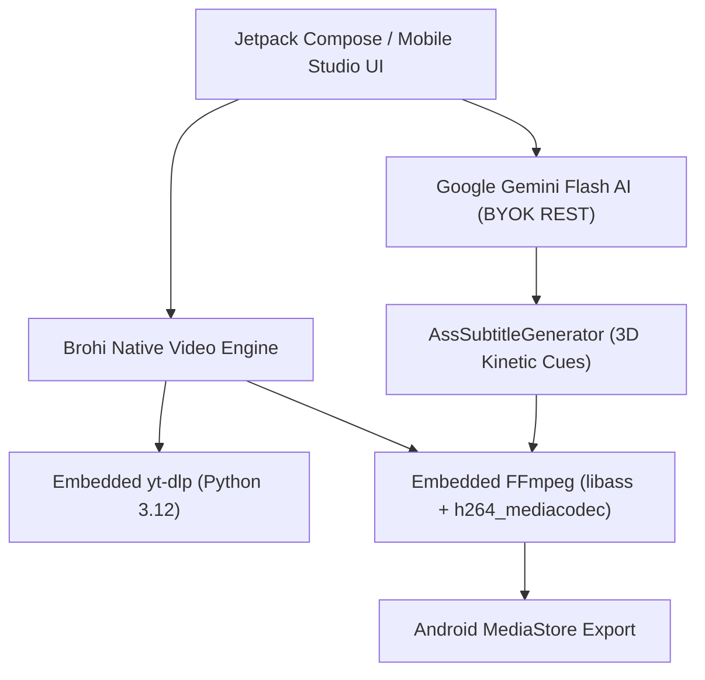

# ⚡ Brohi Clipping — 3D AI Shorts & Reels Studio for Android

<p align="center">
  
  
  
  
  
</p>

---

## 📖 Overview

**Brohi Clipping** is a next-generation Android application that automatically transforms horizontal YouTube/Twitch live streams and long videos into viral **9:16 vertical Shorts & Reels** directly on the mobile device — with **zero backend server costs**.

Powered by client-side **Google Gemini 2.0 Flash AI**, embedded **Python 3.12 (yt-dlp)**, and native **FFmpeg 6.x** hardware rendering.

---

## 🌟 Key Features

* 📡 **Live Stream Radar Scanning**: Extract real-time audio streams from YouTube and Twitch gaming sessions without downloading full multi-gigabyte videos.
* 🤖 **Gemini AI Moment Detection**: Automatically detects hilarious, high-energy, and viral clips with virality potential scoring (80–99%).
* 🧊 **3D Pop-Up Kinetic Subtitles**: Generates high-impact `.ass` subtitles with isometric 3D extrusion shadows and word-by-word bounce animations.
* 🎙️ **AI Voice Hook & Auto-Ducking**: Synthetic speech commentary with intelligent background audio ducking.
* 📐 **9:16 Smart Framing**: Transforms horizontal video using blurred split-backgrounds or centered smart framing.
* 🛡️ **100% Private & Serverless**: Client-side BYOK (Bring Your Own Key) model. All video processing and file generation happens strictly on your device.

---

## 📲 Direct APK Download

Download the verified release ready for installation on Android 10, 11, 12, 13, 14, and 15:

👉 **[Download Brohi Clipping v1.0.0 APK](https://github.com/ShahzaibBrohi-collab/Brohi-clipping/releases/tag/v1.0.0)**

---

## 🛠️ Architecture & Tech Stack



* **Frontend**: Kotlin, Jetpack Compose, Material 3
* **Native Processing**: FFmpeg with `libass` subtitle burning and `h264_mediacodec` hardware acceleration
* **Stream Extraction**: `io.github.junkfood02.youtubedl-android` (Python 3.12 runtime)
* **AI Engine**: Google Gemini Generative AI (Client-side REST)
* **CI/CD**: Automated Cloud Builds with GitHub Actions

---

## 🧑‍💻 Building from Source

```bash
# Clone the repository
git clone https://github.com/ShahzaibBrohi-collab/Brohi-clipping.git
cd Brohi-clipping

# Build debug APK
./gradlew assembleDebug
```

---

## 👤 Author

Developed with ❤️ by **[Shahzaib Brohi](https://github.com/ShahzaibBrohi-collab)**  
*Android & AI Systems Engineer*
